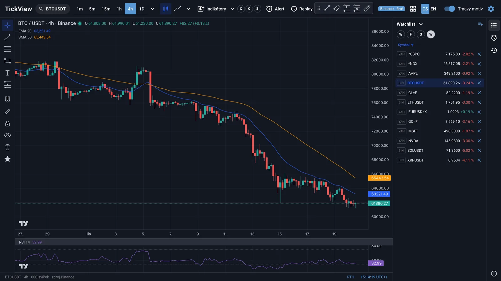

# TickView

Bezplatná open-source alternativa k TradingView – desktopová a webová aplikace
v Pythonu pro svíčkové grafy akcií, ETF, forexu, futures a kryptoměn. Běží
lokálně na Windows, macOS i Linuxu; zdarma, bez registrace a bez reklam.

**Web projektu: https://svopex.github.io/TickView/** (English:
https://svopex.github.io/TickView/en/) – funkce, srovnání s TradingView,
časté otázky a instalace.

*Free, open-source TradingView alternative written in Python – local stock,
forex and crypto charts for Windows, macOS and Linux.*

TickView je nezávislý projekt a není spojen se společností TradingView, Inc.;
grafy vykresluje open-source knihovna Lightweight Charts™ od TradingView
(Apache 2.0). TradingView je ochranná známka společnosti TradingView, Inc.

## Funkce

- **Grafy** – 11 typů (svíčky, Heikin Ashi, Line, Area, Baseline…), timeframy
  1m–1W, tmavý / světlý motiv, časová pásma, seance RTH / ETH, donačítání
  historie při posunu doleva, snímek grafu (Download / Copy image).
- **Více grafů** – rozložení 1–16 grafů se synchronizací symbolu, intervalu,
  crosshairu a času.
- **Indikátory** – 28 vestavěných (SMA, EMA, VWAP, Bollinger, Ichimoku,
  Supertrend, RSI, MACD, ATR, Volume…), COT report a vlastní indikátory
  v Pythonu; Settings se záložkami Inputs / Style / Visibility, šablony.
- **Kreslení** – nástroje jako v TradingView (čáry, kanály, Fibonacci,
  pitchfork, obdélník, text, Long / Short position, měřič), magnet, šablony
  stylu, viditelnost podle timeframu; kresby se ukládají k symbolu.
- **Watchlist** – více seznamů, sekce, barevné vlaječky, řazení, živé ceny.
- **Alerty** – na cenu, čáru kresby nebo signál indikátoru; Telegram, webhook,
  toast a zvuk; vyhodnocuje je server i bez otevřené stránky.
- **Scanner** – indikátor se signály projde až 40 symbolů a výsledek ukáže
  tabulkou v grafu nebo pošle alertem.
- **Replay** – backtest ručních obchodů v historii: příkazy s SL / TP, spread,
  skluz, komise, statistiky a export do CSV.

Rozhraní je česky i anglicky (přepínač CS / EN). Aplikace data jen zobrazuje –
brokerovi žádné příkazy neposílá.

## Instalace a spuštění

Vyžadován Python 3.12 nebo 3.13 (3.14 zatím nepodporuje `numba` z `pandas-ta`).

Stažení bez gitu – macOS / Linux, resp. Windows 10/11:

    curl -L https://github.com/svopex/TickView/archive/refs/heads/main.tar.gz | tar xz
    curl.exe -L -o TickView.zip https://github.com/svopex/TickView/archive/refs/heads/main.zip && tar -xf TickView.zip

S gitem: `git clone https://github.com/svopex/TickView.git`. Aktualizace =
stejné příkazy znovu (nebo `git pull`); `data/` ani `config.yaml` se nepřepíšou.

- **macOS / Linux:** `./run.sh` – najde vhodný Python, vytvoří `.venv`,
  doinstaluje závislosti a spustí aplikaci.
- **Windows:** dvojklik na `run-windows.bat` – navíc chybějící Python
  nainstaluje (bez administrátorských práv) a otevře prohlížeč.
- **Ručně:** `python3 -m venv .venv`, aktivace, `pip install -r
  requirements.txt`, `python main.py`.

Aplikace běží na http://localhost:8095. Parametry (předávají je i skripty):
`--port 8090`, `--open` (otevře prohlížeč), `--native` (nativní okno;
na Linuxu potřebuje GTK nebo Qt). Testy: `python -m unittest`.

Cache svíček, kresby, alerty a nastavení jsou v `data/tickview.db` (SQLite;
jinou složku určí `TICKVIEW_DATA_DIR`). API klíče jsou v `config.yaml`
(necommituje se; šablonu `config.example.yaml` udržujeme aktuální) a dají
se upravit i v aplikaci přes ozubené kolečko → Settings.

## Zdroje dat

| Zdroj | Trhy | Živá data | Potřebuje |
|---|---|---|---|
| Binance | krypto | websocket | nic |
| Yahoo Finance | akcie, ETF, indexy, forex, futures | polling | nic |
| Alpaca | americké akcie (IEX) | websocket 1m, jinak polling | API klíče (Basic zdarma) |
| Interactive Brokers | akcie, forex, kovy, CFD, futures | podle předplatného | běžící TWS / IB Gateway |
| cTrader | forex, kovy, CFD s tick volume | WebSocket | aplikace Open API |
| CFTC | COT report (týdně) | – | nic (app token volitelně) |

- **Alpaca** – klíče v Settings → Alpaca nebo v sekci `alpaca` v `config.yaml`,
  platí po restartu; bez klíčů se zdroj nepřidá.
- **Interactive Brokers** – výchozí `127.0.0.1:7497`, clientId 30 (obsazený →
  zkusí další). Forex `EUR.USD`, kovy a CFD (`XAUUSD`, `IBUS500`, `IBDE40`…),
  kontinuální futures `ES1!`, `GC1!` nebo `KOŘEN1!@BURZA` (bez cenové úpravy,
  roll před expirací). Chybné knoty kotací MIDPOINT se zastřihují. Potřebná
  předplatná dat ukáže Settings → Interactive Brokers → „Jak na předplatné dat“.
- **cTrader** – stačí demo účet u brokera (Pepperstone, IC Markets…).
  Aplikaci založit na https://openapi.ctrader.com, Client ID, Secret, Access
  a Refresh token vložit do Settings → cTrader; token se obnovuje sám. Dodává
  i objem pro forex, kovy a CFD z IBKR (ruční mapování `ctrader.symbols`).
- **COT** – trh se odvodí ze symbolu (futures, forex, kovy, indexy, krypto),
  jinak se zadá kód CFTC; report platí v grafu až od zveřejnění (pátek 15:30 NY).

## Vlastní indikátory

Každý indikátor má adresář `tickview/indicators/custom/<název>/` se souborem
`indicator.py` (třída odvozená od `Indicator` z `tickview/indicators/api.py`
a proměnná `INDICATOR`), `README.md` s popisem a testy v `tests/` (včetně
`__init__.py`; `python -m unittest` je najde). Indikátor importuje jen
`tickview.indicators.api` a pandas / numpy, dostane svíčky, parametry
a `Context` a vrací `Result` – čáry, úsečky, značky, signály pro scanner
a alerty, tabulky a pozadí panelu. Externí data (COT) si vyžádá
v `data_requirements`. Nový indikátor = nový adresář; chyba importu nebo jiná
`API_VERSION` se ukáže v kategorii Vlastní a ostatní indikátory fungují dál.

## Struktura projektu

- `main.py` – vstupní bod (CLI parametry, spuštění UI); `run.sh`,
  `run-windows.bat` a `tools/` – spouštění, kontrola verze Pythonu a překladů
- `tickview/providers/` – zdroje dat za rozhraním `DataProvider` (`base.py`);
  nový zdroj = modul + řádek v `__init__.py`
- `tickview/logic/` – logika bez UI: cache SQLite, alerty, scanner, replay,
  COT, objem, styly a šablony, watchlisty, rozložení, seance
- `tickview/services/` – služby na pozadí: alerty, scanner, replay,
  připomínky, notifikace (Telegram, webhook), COT a objem
- `tickview/indicators/` – rozhraní (`api.py`), vestavěné (`builtin.py`), COT,
  registr a výpočet; vlastní indikátory v `custom/`
- `tickview/ui/` – NiceGUI stránka (`main_window.py`), graf (`chart_pane.py`,
  `lightweight_chart.py`), dialogy a `static/` (JS grafu, CSS, vendored
  Lightweight Charts 4.2.3)
- `tickview/i18n.py` + `tickview/locales/` – překlady: české texty jsou klíče;
  nové texty vždy přes `tr()` / `N_()`, v JS `tvTr()` se slovníkem `js.py`
  (úplnost hlídá `tools/i18n_check.py`)
- `tests/` – unit testy
- `index.html`, `en/`, `site/` – web projektu (aplikace ho nepoužívá)

## Web projektu (GitHub Pages)

Statický web `index.html` (cs) a `en/index.html` (en) se sdílenými assety
v `site/`; obsah obou verzí udržujeme 1:1. Nasazení: Settings → Pages →
větev `main`, složka `/ (root)`. Náhled: `python3 -m http.server`. Při úpravách:

- změna souborů v `site/` → zvýšit `?v=` u odkazů na CSS a JS v obou HTML;
- změna FAQ → text na stránce i v JSON-LD `FAQPage`;
- nová verze aplikace → `softwareVersion` v JSON-LD;
- změna obsahu → `lastmod` v `sitemap.xml`.

E-mail je v `data-email` obrácený a v base64 (skládá ho `site/script.js`);
`llms.txt` je popis pro jazykové modely, `632709df….txt` klíč IndexNow.

## Licence

Copyright 2026 Svopex

Projekt je licencovaný pod [Apache License 2.0](LICENSE). Vendored knihovna
Lightweight Charts v `tickview/ui/static/` má vlastní licenci Apache-2.0
(Copyright TradingView, Inc.).
